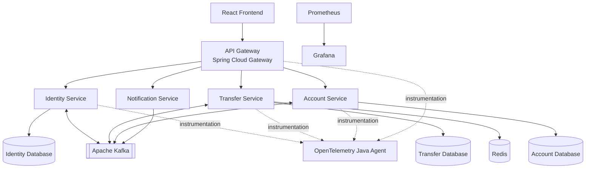

# P2P Payment Ledger

A distributed peer-to-peer payment ledger built with **Java 21, Spring Boot, Apache Kafka, PostgreSQL, and Redis**.

P2P Payment Ledger is a portfolio project demonstrating how a financial-style transaction system can be designed around microservices, an append-only ledger, asynchronous event processing, and operational observability.

The application supports user authentication, multi-currency wallets, peer-to-peer transfers, transaction history, and real-time notifications. Backend services run in Docker containers and communicate through HTTP and Kafka.

> **Project status:** Functional portfolio project with local Docker Compose deployment. This is an educational application, not a production payment platform. It does not process real money or integrate with banking or payment providers.

## Features

### Payments and ledger
- Peer-to-peer transfers using the recipient's email address.
- Multi-currency wallets for EUR, USD, and RUB.
- Append-only ledger entries representing debits and credits.
- Wallet balances calculated from ledger entries rather than stored as mutable balance fields.
- Transaction history and account-ownership checks.
- Idempotency support for transfer requests.
- Database locking to coordinate concurrent transfers and protect account consistency.

### Authentication and security
- User registration and login.
- JWT-based authentication using an HTTP-only cookie.
- API Gateway authentication and propagation of the authenticated user's identity to downstream services.
- Internal service authentication mechanisms.
- Separation of public API access from internal service communication.

### Distributed processing
- Asynchronous communication through Apache Kafka.
- Transactional outbox pattern for publishing events from database-backed workflows.
- Processed-event tracking to prevent duplicate event handling.
- Retry and recovery mechanisms for outbox publishing.
- Event-driven account initialization after user registration.
- Asynchronous transfer processing and transaction status updates.
- Server-Sent Events (SSE) for real-time notifications.

### Observability
- Application logging.
- Metrics collection with Micrometer and Prometheus.
- Metrics visualization with Grafana.
- Distributed tracing instrumentation using the OpenTelemetry Java Agent.
- Trace and span context to help investigate request flows.

## Architecture

The system is organized as a Maven multi-module project.



Kafka event flows are asynchronous. The transactional outbox pattern is used where database changes must be reliably coordinated with event publication.

### Services

| Module | Responsibility |
|---|---|
| `api-gateway` | Entry point for client requests, routing, and authentication enforcement |
| `identity-service` | User registration, login, and identity management |
| `account-service` | Wallet management, ledger entries, balance calculation, and statements |
| `transfer-service` | Transfer orchestration, idempotency, and transaction lifecycle |
| `notification-service` | Real-time notification delivery through SSE |
| `dfls-shared-dto` | Shared data-transfer objects used across modules |

Each core business service has a separate PostgreSQL database. Redis supports transfer idempotency, while Kafka handles asynchronous communication between services.

### Transfer lifecycle

1. The client submits a transfer request through the API Gateway.
2. The Transfer Service records the transaction and an outbox event in a database transaction.
3. An outbox publisher sends the event to Kafka.
4. The Account Service validates the transfer and writes the corresponding ledger entries, or rejects the transfer.
5. The Account Service publishes a result event through its outbox.
6. The Transfer Service consumes the result and updates the transaction status.
7. The Notification Service consumes the result event and sends SSE notifications.

## Technology stack

| Area | Technologies |
|---|---|
| Language | Java 21 |
| Backend | Spring Boot, Spring Cloud Gateway, Spring Data JPA |
| Build | Maven |
| Databases | PostgreSQL 16 |
| Messaging | Apache Kafka |
| Caching / idempotency | Redis 7 |
| Schema management | Liquibase |
| Frontend | React 18, Vite, JavaScript |
| Metrics | Micrometer, Prometheus, Grafana |
| Tracing instrumentation | OpenTelemetry Java Agent |
| Deployment | Docker, Docker Compose |

## Key engineering decisions

### 1. Ledger-based balance calculation

Wallet balances are derived from ledger entries instead of being stored as mutable account balances. Each transfer produces corresponding debit and credit entries. This makes the transaction history the source of truth for balances and provides an auditable record of account activity.

### 2. Idempotent transfer requests

Transfer requests support idempotency keys to reduce the risk of processing the same request more than once when clients retry after timeouts or network failures. Redis tracks request processing, while database-level consistency mechanisms protect ledger operations.

### 3. Transactional outbox pattern

A database transaction and Kafka publication cannot generally be committed as one ordinary atomic transaction across both systems. The outbox pattern addresses this by persisting an event in the same database transaction as the relevant business change. A background publisher subsequently sends the event to Kafka.

The publisher supports batch processing, record claiming, retries, and recovery from interrupted processing.

### 4. Duplicate event handling

Consumers track processed event identifiers to prevent duplicate deliveries from applying the same business operation repeatedly. For this protection to work, the database changes and processed-event record must be coordinated transactionally.

### 5. Concurrency control

Concurrent transfers may attempt to modify the same wallets. Database locking helps serialize conflicting operations and protect against inconsistent ledger updates. Wallets are locked in a consistent order to reduce the risk of deadlocks when a transfer involves two accounts.

### 6. Microservices and observability

The application separates identity, account, transfer, and notification responsibilities into distinct services. Prometheus and Grafana support metrics inspection, while OpenTelemetry instrumentation helps investigate requests across service boundaries. Docker Compose provides a repeatable local environment for running the application and its infrastructure.

## Getting started

### Prerequisites

Install the following:

- Java 21
- Maven, or the project's Maven Wrapper if provided
- Docker Engine and Docker Compose
- Node.js and npm for the frontend
- Git

### 1. Clone the repository

```bash
git clone https://github.com/maxrazor/P2P_Payment_Ledger.git
cd P2P_Payment_Ledger
```

### 2. Configure environment variables

Create a local `.env` file from the example:

```bash
cp .env.example .env
```

On Windows PowerShell:

```powershell
Copy-Item .env.example .env
```

Fill in the required local development credentials and secrets. Use unique values for your local environment, and **never commit `.env`**.

Ensure the OpenTelemetry Java Agent is available at the path expected by the Compose configuration, or update the configuration to use your chosen agent distribution.

### 3. Start the backend and infrastructure

```bash
docker compose up --build -d
```

Check the running containers:

```bash
docker compose ps
```

Follow the logs when troubleshooting startup:

```bash
docker compose logs -f
```

Stop the application:

```bash
docker compose down
```

Persistent data is stored in Docker volumes. To reset the local databases and other named volumes, run the following **only if you are happy to lose all persisted development data**:

```bash
docker compose down -v
```

### 4. Start the frontend

Open a separate terminal and navigate to the frontend directory:

```bash
cd p2p-ledger-frontend
npm install
npm run dev
```

Configure the frontend to use the API Gateway at [http://localhost:8080](http://localhost:8080) according to the project's frontend configuration. If the frontend uses a development proxy, configure it accordingly. The frontend and backend must agree on the API base URL and authentication-cookie behavior.

### 5. Access the application

The following addresses are based on the current local Compose port mappings.

| Component | Local address |
|---|---|
| Frontend | Vite development URL printed in the terminal |
| API Gateway | [http://localhost:8080](http://localhost:8080) |
| Identity Service | [http://localhost:8081](http://localhost:8081) |
| Transfer Service | [http://localhost:8082](http://localhost:8082) |
| Account Service | [http://localhost:8083](http://localhost:8083) |
| Notification Service | [http://localhost:8084](http://localhost:8084) |
| Prometheus | [http://localhost:9090](http://localhost:9090) |
| Grafana | [http://localhost:3000](http://localhost:3000) |

The backend service ports are published by the current development Compose configuration. In a hardened deployment, consider exposing only the gateway and required monitoring interfaces.

Document Grafana credentials and any required initial setup in the local environment configuration. Do not publish real credentials.

## Testing

The project includes unit tests, integration tests, and end-to-end tests covering core business logic, security boundaries, and distributed transfer processing. Some scenarios also require local infrastructure, depending on test configuration.

### Unit and component test coverage

- **Identity and authentication:** registration, duplicate email handling, password hashing and verification, login, JWT claims, cookie handling, and authentication failures.
- **API Gateway:** JWT validation, expired and invalid tokens, trusted-header sanitization, role propagation, request routing, and downstream service failures.
- **Account and ledger:** wallet creation, duplicate wallet prevention, account resolution, balance calculation, ledger debit/credit entries, statements, and account ownership checks.
- **Transfers:** request validation, idempotency, insufficient funds, missing accounts, currency mismatches, and transaction status transitions.
- **Outbox processing:** successful publishing, retry behavior, and permanent publishing failures.
- **Notifications:** SSE subscriptions, successful and rejected transfer notifications, malformed events, and concurrent subscriptions.

### Integration and end-to-end scenarios

Integration tests cover concurrent overdraft attempts, user registration and lifecycle behavior, and the transactional outbox pipeline. End-to-end scenarios verify the distributed transfer workflow across the Transfer and Account services, including transaction processing and final status updates.

Run the Maven test suite from the repository root:

```bash
mvn test
```

To run the Maven verification lifecycle:

```bash
mvn verify
```

Alternatively, build the project with:

```bash
mvn clean package
```

If the project includes the Maven Wrapper, use `./mvnw` on Unix-like systems or `.\mvnw.cmd` on Windows instead of `mvn`.

Some integration tests may require PostgreSQL, Kafka, Redis, or other configured services to be available. Check the test configuration before running the suite in a clean environment.

## Current limitations and future improvements

This project focuses on core ledger and distributed-processing behavior. Potential areas for further development include:

- Adding funds through a user-facing, audited funding workflow rather than a manual administrative endpoint.
- Updating user profile information.
- Expanding API response DTO consistency where useful.
- Strengthening security configuration and deployment hardening.
- Adding more automated integration and failure-recovery tests.
- Improving operational documentation, dashboards, and alerting.
- Evaluating additional production concerns such as rate limiting, secrets management, backups, and disaster recovery.

The application is intended for learning and demonstration. It is not a certified or production-grade financial system.

## Repository structure

```text
P2P_Payment_Ledger/
├── api-gateway/
├── identity-service/
├── account-service/
├── transfer-service/
├── notification-service/
├── dfls-shared-dto/
├── p2p-ledger-frontend/
├── tools/
├── monitoring/
├── docker-compose.yml
├── pom.xml
└── README.md
```

This tree shows the main modules and infrastructure directories; additional files and directories may be present in the repository.