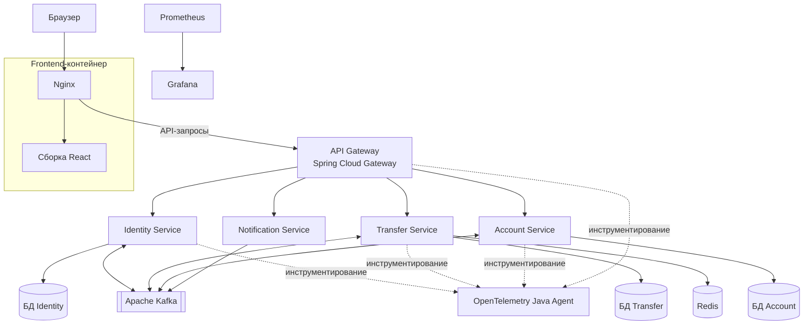

# P2P Payment Ledger

[Read in English (README.md)](README.md)

**Распределённая система P2P-переводов** на Java 26 с использованием Spring Boot, Apache Kafka, PostgreSQL и Redis.

Проект представляет собой прототип платёжного ledger-приложения, в котором переводы между пользователями обрабатываются несколькими взаимодействующими сервисами. Основной акцент сделан на согласованности финансовых операций, надёжной асинхронной обработке событий, идемпотентности запросов и наблюдаемости распределённой системы.

Реализованы регистрация и аутентификация пользователей, кошельки в нескольких валютах, переводы по email, история операций и уведомления в реальном времени. Сервисы и инфраструктура запускаются локально с помощью Docker Compose.

> **Статус проекта:** работающий учебный проект с локальным запуском через Docker Compose. Это демонстрационная система: она не обрабатывает реальные деньги и не интегрирована с банками или платёжными провайдерами.

## Что реализовано

### Переводы и учёт операций
- P2P-переводы по email получателя.
- Кошельки в EUR, USD и RUB.
- Неизменяемые записи ledger для отражения дебетовых и кредитовых операций.
- Расчёт баланса на основе записей ledger, без хранения изменяемого поля баланса в кошельке.
- История операций и проверка принадлежности счёта пользователю.
- Идемпотентность запросов на перевод.
- Блокировки на уровне базы данных для координации конкурентных переводов и защиты целостности данных.

### Аутентификация и безопасность
- Регистрация и вход пользователей.
- JWT-аутентификация с хранением токена в cookie с флагом `HttpOnly`.
- API Gateway как единая точка входа: маршрутизация запросов и проверка аутентификации.
- Передача идентификатора аутентифицированного пользователя во внутренние сервисы.
- Механизмы аутентификации межсервисных запросов.
- Разделение публичных API и внутреннего взаимодействия сервисов.

### Распределённая обработка
- Асинхронное взаимодействие сервисов через Apache Kafka.
- Transactional Outbox для публикации событий, связанных с изменениями в базе данных.
- Учёт обработанных событий для защиты от повторного выполнения одной операции.
- Повторные попытки публикации и восстановление после прерывания обработки outbox-записей.
- Создание кошелька после регистрации пользователя через событийный сценарий.
- Асинхронная обработка переводов и обновление их статусов.
- Уведомления в реальном времени через Server-Sent Events (SSE).

### Наблюдаемость
- Прикладное логирование.
- Сбор метрик с Micrometer и Prometheus.
- Визуализация метрик в Grafana.
- Инструментирование распределённых запросов с помощью OpenTelemetry Java Agent.
- Использование контекста trace/span для расследования прохождения запроса между сервисами.

## Архитектура

Проект организован как многомодульный Maven-проект. Пользовательский интерфейс работает в отдельном контейнере; запросы к API направляются через API Gateway. Основные бизнес-сервисы используют отдельные базы PostgreSQL, Redis применяется для поддержки идемпотентности, а Kafka — для асинхронного обмена событиями.



Асинхронные сценарии построены на событиях Kafka. Там, где изменение данных и публикация события должны быть согласованы, используется **Transactional Outbox**: событие сначала сохраняется в той же транзакции базы данных, что и бизнес-изменение, а затем публикуется отдельным процессом.

### Сервисы и модули

| Модуль | Ответственность |
|---|---|
| `api-gateway` | Единая точка входа, маршрутизация запросов и проверка аутентификации |
| `identity-service` | Регистрация, вход и управление идентификационными данными пользователей |
| `account-service` | Кошельки, записи ledger, расчёт баланса и выписки |
| `transfer-service` | Координация переводов, идемпотентность и жизненный цикл транзакции |
| `notification-service` | Доставка уведомлений в реальном времени через SSE |
| `dfls-shared-dto` | Общие DTO для взаимодействия модулей |

Каждый основной бизнес-сервис использует отдельную базу PostgreSQL. Redis поддерживает идемпотентность переводов, а Kafka обеспечивает асинхронное взаимодействие между сервисами.

### Жизненный цикл перевода

1. Клиент отправляет запрос на перевод через API Gateway.
2. Transfer Service сохраняет транзакцию и событие outbox в рамках одной транзакции базы данных.
3. Фоновый publisher отправляет событие в Kafka.
4. Account Service проверяет возможность перевода и записывает соответствующие дебетовую и кредитовую операции в ledger либо отклоняет перевод.
5. Account Service публикует результат через собственный outbox.
6. Transfer Service получает событие результата и обновляет статус транзакции.
7. Notification Service получает результат и отправляет уведомление клиенту через SSE.

Такой подход разделяет координацию перевода и изменение ledger, позволяя сервисам обмениваться результатами асинхронно.

## Технологический стек

| Область | Технологии |
|---|---|
| Язык | Java 26 |
| Backend | Spring Boot, Spring WebFlux, Spring Cloud Gateway, Spring Data JPA |
| Сборка | Maven |
| Базы данных | PostgreSQL 16 |
| Обмен сообщениями | Apache Kafka |
| Идемпотентность | Redis 7.2 |
| Миграции схемы БД | Liquibase |
| Frontend | React 18, Vite, JavaScript, Node.js 22 |
| Веб-сервер | Nginx |
| Метрики | Micrometer, Prometheus, Grafana |
| Трассировка | OpenTelemetry Java Agent |
| Запуск и окружение | Docker, Docker Compose |

## Ключевые инженерные решения

### 1. Баланс как результат записей ledger

Баланс кошелька рассчитывается на основе записей ledger, а не хранится в виде изменяемого поля. Для перевода создаются соответствующие дебетовая и кредитовая записи. Таким образом, источником данных о балансе остаётся история операций, которую можно использовать для проверки и аудита изменений.

### 2. Идемпотентность запросов на перевод

Клиент передаёт idempotency key, чтобы повторная отправка запроса после тайм-аута или сетевой ошибки не приводила к повторной обработке той же операции. Redis используется для отслеживания состояния обработки запроса, а согласованность операций с ledger дополнительно защищается механизмами базы данных.

### 3. Transactional Outbox

Изменение данных в базе и публикация сообщения в Kafka не объединяются в одну обычную атомарную транзакцию. Поэтому событие сохраняется в outbox в рамках той же транзакции, что и бизнес-изменение. Отдельный publisher затем отправляет его в Kafka.

Реализованы пакетная обработка outbox-записей, захват записей для публикации, повторные попытки и восстановление после прерывания обработки.

### 4. Защита от повторной обработки событий

Потребители сохраняют идентификаторы обработанных событий, чтобы повторная доставка сообщения не приводила к повторному выполнению бизнес-операции. Запись о событии и соответствующие изменения данных должны фиксироваться согласованно в рамках транзакции.

### 5. Контроль конкурентного доступа

Несколько переводов могут одновременно затрагивать один и тот же кошелёк. Блокировки на уровне базы данных помогают сериализовать конфликтующие операции и защищать целостность ledger. При переводе между двумя счетами блокировки берутся в едином порядке, что снижает риск взаимных блокировок (deadlock).

### 6. Разделение ответственности и наблюдаемость

Идентификация пользователей, работа со счетами, координация переводов и уведомления вынесены в отдельные сервисы. Prometheus и Grafana используются для анализа метрик, а OpenTelemetry помогает исследовать прохождение запросов между сервисами. Docker Compose обеспечивает воспроизводимый локальный запуск приложения и инфраструктуры.

## Запуск проекта

### Требования

Установите:
- Docker Engine и Docker Compose;
- Git.

### 1. Клонирование репозитория

```bash
git clone https://github.com/maxrazor/P2P_Payment_Ledger.git
cd P2P_Payment_Ledger
```

### 2. Настройка переменных окружения

Создайте локальный `.env` на основе примера:

```bash
cp .env.example .env
```

В Windows PowerShell:

```powershell
Copy-Item .env.example .env
```

Заполните необходимые локальные учётные данные и секреты. Используйте отдельные значения для своего окружения и **не добавляйте `.env` в Git**.

Убедитесь, что OpenTelemetry Java Agent доступен по пути, который ожидает конфигурация Compose, либо скорректируйте путь под используемый дистрибутив агента.

### 3. Запуск приложения и инфраструктуры

```bash
docker compose up --build -d
```

Проверить состояние контейнеров:

```bash
docker compose ps
```

Посмотреть логи при диагностике проблем запуска:

```bash
docker compose logs -f
```

### 4. Адреса локальных сервисов

После запуска откройте frontend:

[http://localhost:3000](http://localhost:3000)

Frontend обслуживается Nginx и направляет API-запросы в API Gateway на порту `8080`.

| Компонент | Локальный адрес |
|---|---|
| Frontend | [http://localhost:3000](http://localhost:3000) |
| API Gateway | [http://localhost:8080](http://localhost:8080) |
| Identity Service | [http://localhost:8081](http://localhost:8081) |
| Transfer Service | [http://localhost:8082](http://localhost:8082) |
| Account Service | [http://localhost:8083](http://localhost:8083) |
| Notification Service | [http://localhost:8084](http://localhost:8084) |
| Prometheus | [http://localhost:9090](http://localhost:9090) |
| Grafana | [http://localhost:3001](http://localhost:3001) |

Порты backend-сервисов опубликованы в текущей конфигурации Compose для разработки. Для более защищённого развёртывания следует открывать только Gateway и необходимые интерфейсы мониторинга.

Проверьте учётные данные Grafana и первоначальные настройки локального окружения. Не публикуйте реальные пароли и секреты.

### 5. Остановка приложения

Остановить контейнеры, сохранив именованные тома:

```bash
docker compose down
```

Чтобы удалить локальные базы данных и остальные именованные тома, выполните следующую команду **только если сохранённые данные больше не нужны**:

```bash
docker compose down -v
```

### Запуск frontend отдельно (необязательно)

Для разработки frontend вне Docker установите Node.js 22 и npm, затем выполните:

```bash
cd p2p-ledger-frontend
npm install
npm run dev
```

При необходимости настройте окружение Vite так, чтобы frontend обращался к API Gateway по адресу `http://localhost:8080`.

## Тестирование

В проекте есть модульные, интеграционные и end-to-end тесты для ключевой бизнес-логики, границ безопасности и распределённой обработки переводов. Для некоторых сценариев в зависимости от конфигурации тестов требуется запущенная инфраструктура.

### Что покрыто тестами

- **Identity и аутентификация:** регистрация, обработка повторного email, хеширование и проверка пароля, вход, JWT claims, работа cookie и ошибки аутентификации.
- **API Gateway:** проверка JWT, просроченные и некорректные токены, очистка доверенных заголовков, передача ролей, маршрутизация и ошибки downstream-сервисов.
- **Account и ledger:** создание кошелька, защита от дублирования, поиск счёта, расчёт баланса, дебетовые и кредитовые записи, выписки и проверка владельца счёта.
- **Переводы:** валидация запросов, идемпотентность, недостаток средств, отсутствующие счета, несовпадение валют и переходы статусов транзакции.
- **Outbox:** успешная публикация, повторные попытки и окончательные ошибки публикации.
- **Уведомления:** SSE-подписки, уведомления об успешных и отклонённых переводах, некорректные события и параллельные подписки.

### Интеграционные и end-to-end сценарии

Интеграционные тесты охватывают конкурентные попытки списать больше доступного остатка, жизненный цикл пользователя и обработку событий через transactional outbox. End-to-end сценарии проверяют распределённый процесс перевода между Transfer Service и Account Service, включая обработку операции и обновление итогового статуса.

Запустить тесты Maven из корня репозитория:

```bash
mvn test
```

Запустить полный цикл Maven Verification:

```bash
mvn verify
```

Или собрать проект:

```bash
mvn clean package
```

Если в репозитории есть Maven Wrapper, вместо `mvn` можно использовать `./mvnw` в Unix-подобных системах или `.\mvnw.cmd` в Windows.

Некоторым интеграционным тестам могут требоваться PostgreSQL, Kafka, Redis или другие настроенные сервисы. Перед запуском тестов в чистом окружении проверьте их конфигурацию.

## Ограничения и дальнейшее развитие

Сейчас проект сосредоточен на учёте операций и распределённой обработке. Возможные направления развития:

- Реализовать пользовательский и аудируемый сценарий пополнения кошелька вместо ручного административного механизма.
- Добавить редактирование профиля пользователя.
- При необходимости унифицировать DTO ответов API.
- Усилить настройки безопасности и защиту окружения развёртывания.
- Расширить автоматические интеграционные тесты и проверки восстановления после сбоев.
- Развить документацию по эксплуатации, дашборды и оповещения.
- Проработать дополнительные эксплуатационные аспекты: rate limiting, управление секретами, резервное копирование и восстановление после аварий.

Проект предназначен для изучения и демонстрации инженерных подходов. Он не является сертифицированной или готовой к промышленной эксплуатации финансовой системой.

## Структура репозитория

```text
P2P_Payment_Ledger/
├── api-gateway/
├── identity-service/
├── account-service/
├── transfer-service/
├── notification-service/
├── dfls-shared-dto/
├── p2p-ledger-frontend/
│   ├── src/
│   ├── Dockerfile
│   ├── nginx.conf
│   ├── package.json
│   ├── package-lock.json
│   └── vite.config.js
├── tools/
├── monitoring/
├── docs/
│   └── architecture.md
├── docker-compose.yml
├── pom.xml
├── README.md
├── LICENSE
├── .env.example
└── .gitignore
```

Это основные модули и каталоги инфраструктуры; в репозитории также могут присутствовать дополнительные файлы и директории.
